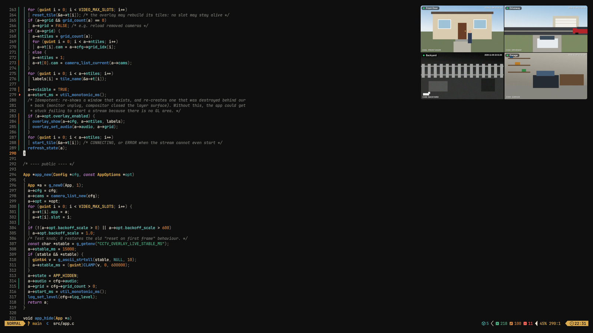
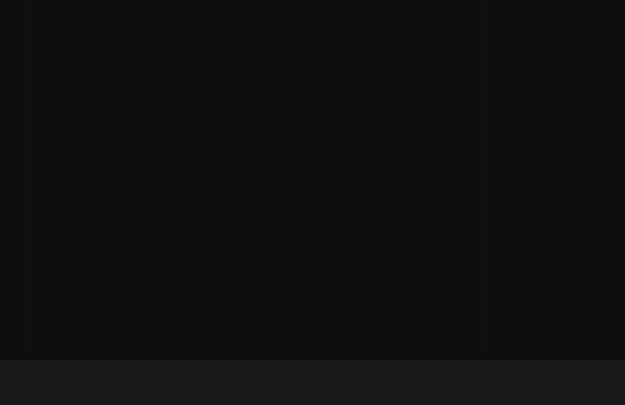
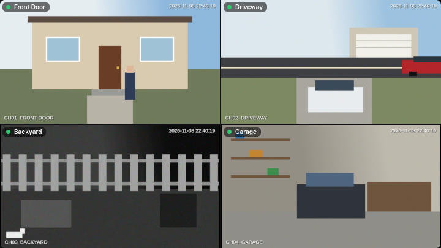
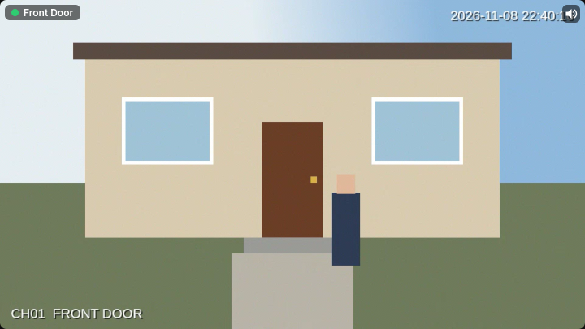
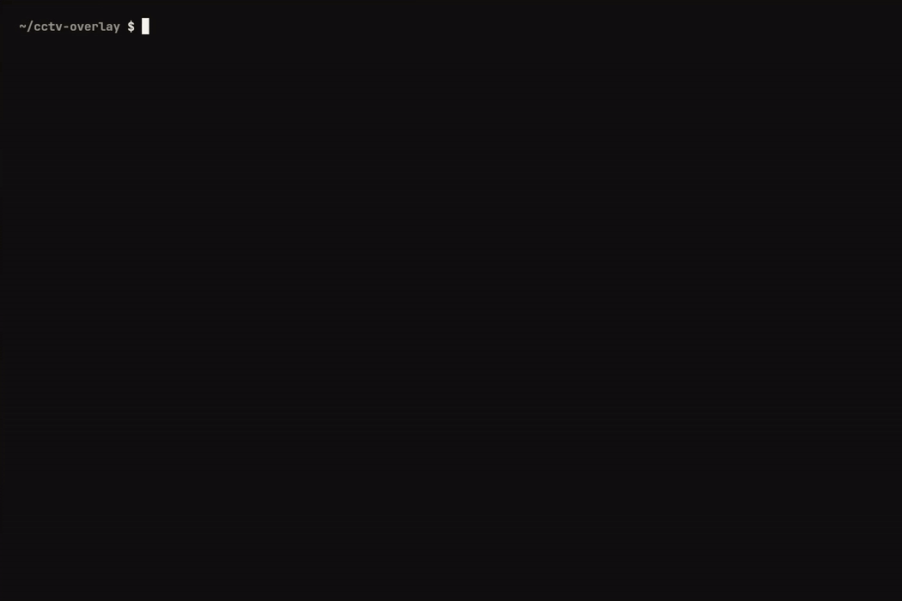

# CCTV Overlay for Linux

Keep an eye on your security cameras while you work or play. **cctv-overlay** shows your CCTV cameras in a
small, always-on-top, click-through window on a Wayland desktop: a **4-camera grid** at a glance, then each
camera on its own, with optional **audio**, all driven by a few keys.



<sub>All demo images use synthetic test cameras from [`tools/demo/`](tools/demo/), not real footage.</sub>

## How it works

<p align="center"></p>

| Key (default) | What happens |
|---|---|
| **Ctrl + Num \*** | Show or hide the overlay. It always opens on the **grid** of the first four cameras. |
| **Num \*** | Next view: grid → camera 1 → camera 2 → … → last camera → grid. |
| **Num /** | Previous view (same ring, backwards). |
| **Ctrl + Num −** | Camera **audio** on/off. A small speaker icon shows while sound is on. |

Every key is your choice; the installer asks. ([High-quality MP4](docs/media/usage.mp4))

| Grid view | Single camera, audio on |
|---|---|
|  |  |

## Features

- **Over everything.** Sits in the Wayland layer-shell `overlay` layer: above normal, maximised and fullscreen
  windows, on the monitor and corner you pick.
- **Never in the way.** Takes no keyboard focus and has an empty input region, so typing and clicks go to the app
  underneath.
- **4-camera grid plus single views.** Each grid tile is its own stream that reconnects on its own, so one offline
  camera doesn't affect the others.
- **Fast and light.** libmpv with VA-API hardware decoding and a low-latency profile. On a Dahua NVR a camera
  appears in about 0.8 s. With the overlay hidden, **nothing runs**: no player, no network connection, no GPU
  surface.
- **Works with most camera systems.** Presets for Dahua / Amcrest / Lorex, Hikvision / HiLook / Annke, Reolink and
  Uniview recorders, and for separate IP cameras (including TP-Link Tapo). Any other system can use an RTSP path
  template.
- **Safe with your password.** It lives only in a `0600` secrets file. It never appears in config files, command
  lines, logs or status output, and the installer reads it from a hidden prompt.
- **Scriptable.** A small CLI (`cctv-overlay toggle | next | prev | grid | audio | status --json | …`) talks
  to a per-user daemon over a Unix socket. There is no network listener.

## Use cases

- **Gaming or watching fullscreen** while keeping an eye on the driveway or front door.
- **Working from home:** see who's at the door without leaving your editor or call.
- **Waiting for a delivery:** keep the front-door camera pinned in a corner.
- **Kids or pets in the backyard:** one key for a quick check, the same key to hide it.
- **Night-time check** from a second monitor, with audio when you need to hear what's going on.

## Requirements

| | Minimum |
|---|---|
| OS / session | Linux, **Wayland** (no X11) |
| Compositor | One with **wlr-layer-shell**: Hyprland (tested; Omarchy 4.5 / Hyprland 0.56), Sway, river, KDE Plasma 6, … **Not GNOME.** |
| Libraries | GTK 4.12+, gtk4-layer-shell 1.0+, libmpv (mpv 0.35+), GLib 2.74+, json-glib, libepoxy |
| Build tools | C compiler, `make`, `pkg-config`; the installer also needs `bash`, `python3`, `jq` |
| GPU | OpenGL via EGL; **VA-API recommended** (the grid decodes four streams) |
| Cameras | An NVR/DVR or IP cameras serving **RTSP** (H.264/H.265) on your network |

Arch / Omarchy: `sudo pacman -S --needed base-devel pkgconf glib2 json-glib libepoxy gtk4 gtk4-layer-shell mpv jq python`
(the installer offers to do this). The full list, compositor support and camera paths are in
[`docs/requirements.md`](docs/requirements.md), and `./install.sh --check` tests your machine without changing
anything.

## Install

```sh
git clone https://github.com/Kaibur02/cctv-overlay.git
cd cctv-overlay
./install.sh
```

<p align="center"></p>

The installer:

1. checks the requirements, builds, and installs to `~/.local/bin` (no root);
2. asks **which camera system** you have, **how many cameras**, and a **name** (and channel) for each;
3. asks for the **monitor**, **size** and **corner**;
4. asks which **keys** to use for show/hide, next, previous and audio, and writes them into your Hyprland config
   (in a marked block, after a backup, undone automatically if Hyprland reports an error);
5. asks for the **password** in a hidden prompt and stores it only in `secrets.ini` (mode 0600);
6. opens the overlay once and reports whether each camera is live.

Running it again keeps your existing setup unless you choose to replace it. ([High-quality MP4](docs/media/install.mp4))

**Installing with an AI assistant?** Give it [`docs/ai-install.md`](docs/ai-install.md). It asks you the questions
in chat, runs the installer unattended, and leaves only the password for you to type (in Claude Code:
`! ./install.sh --set-password`). Your password never goes through the chat.

Other installer modes: `--check`, `--set-password`, `--test`, `--answers FILE --yes`, `--uninstall`.
Manual build, the Arch `PKGBUILD` and the systemd user unit: [`docs/install.md`](docs/install.md).

**No cameras yet?** `make && tools/demo/run-demo.sh start` runs five synthetic cameras locally;
`tools/demo/run-demo.sh ctl toggle` shows them.

## Customisation

Everything lives in `~/.config/cctv-overlay/config.ini`. Edit it and run `cctv-overlay reload`, or re-run
`./install.sh`. Every key is documented in [`docs/configuration.md`](docs/configuration.md).

| What | Where | Example |
|---|---|---|
| Monitor | `[general] monitor` | `DP-1`, `HDMI-A-1`, or `focused` |
| Size and corner | `[overlay] width`, `height`, `anchor`, `margin_x/y` | `720` × `405`, `top-right` |
| Labels and status dots | `[overlay] show_label`, `show_status` | `false` for a clean picture |
| Main or sub stream | `[stream] subtype`, or per camera | `0` sharp / fast to open, `1` light |
| Decoder | `[stream] hwdec` | `vaapi`, `auto-safe`, `no` |
| Audio at start | `[stream] audio` | `true` |
| Which cameras are in the grid, and their order | `[grid] cameras` | `driveway, front, backyard, garage` |
| Lighter streams for the grid only | `[grid] subtype` | `1` |
| No grid (plain camera ring) | `[grid] enabled` | `false` |
| Camera order, names, channels | `[camera.<id>]` sections, in file order | `name = Front Door`, `channel = 1` |
| Other camera systems | `[recorder] path` template, or per-camera `host`/`port`/`path` | `/Streaming/Channels/{channel}0{stream}` |
| Keys | your Hyprland config (managed block), or re-run the installer | `SUPER + F9` |

```ini
[overlay]
width = 720
height = 405
anchor = bottom-right

[grid]
cameras = driveway, front, backyard, garage

[camera.front]
name = Front Door
channel = 1
```

## Commands

| Command | Effect |
|---|---|
| `cctv-overlay toggle` | Show or hide (opens on the grid) |
| `cctv-overlay next` / `prev` | Next or previous view: grid → cameras → grid |
| `cctv-overlay grid` | Switch to the grid |
| `cctv-overlay show CAMERA` | Open one camera (name, id or zero-based index) |
| `cctv-overlay audio [on\|off]` | Toggle or set audio |
| `cctv-overlay hide` | Close and release everything |
| `cctv-overlay status [--json]` | State, view, camera, tiles, audio, last error (never credentials) |
| `cctv-overlay list` | Configured cameras |
| `cctv-overlay check` | Validate config and secrets offline (prints no secrets) |
| `cctv-overlay reload` | Re-read config and secrets |
| `cctv-overlay daemon` | Run the daemon in a terminal (it otherwise starts on the first command) |
| `cctv-overlay quit` / `ping` | Stop the daemon / health check |

Exit codes, states and the JSON format: [`docs/behaviour.md`](docs/behaviour.md).

## Security

- The repository contains no credentials, and the examples contain placeholders only.
- The password lives in `secrets.ini` (mode `0600`) or the `CCTV_OVERLAY_PASSWORD` environment variable, never on
  a command line or in `config.ini`. The stream URL with credentials exists only while a stream starts, and is
  wiped after use.
- Logs and errors are redacted. The control socket is `0600` in `$XDG_RUNTIME_DIR` and accepts only your user.
  There is no network listener.
- RTSP itself is unencrypted. Use a view-only camera account on a trusted network.

Report vulnerabilities privately: see [`SECURITY.md`](SECURITY.md).

## Limitations

- Wayland with layer-shell only (GNOME and X11 are not supported). Daily use and testing are on Hyprland; other
  layer-shell compositors should work but are untested.
- All cameras share one user name and password. A camera with different credentials needs a `url` override,
  which puts its password in `config.ini` (discouraged).
- Presets other than Dahua follow the vendors' documented RTSP paths but haven't been tested on real hardware
  yet. Reports are welcome.
- The grid never plays sound. Audio makes mpv sync video to the audio clock, which can add a little latency.
- While the overlay is visible, Hyprland turns off direct scanout for a fullscreen window on that monitor. The
  cost was not noticeable in daily use.
- There is no recording, motion alerts or PTZ control: this is a viewer.
- Smaller known items from the security and lifecycle reviews are listed in [`ARCHITECTURE.md`](ARCHITECTURE.md) §13.

## Documentation

| Document | For |
|---|---|
| [`docs/requirements.md`](docs/requirements.md) | Minimum requirements, compositors, camera systems |
| [`docs/install.md`](docs/install.md) | Installer modes, manual build/install, PKGBUILD, systemd unit |
| [`docs/ai-install.md`](docs/ai-install.md) | Step-by-step install for an AI assistant |
| [`docs/configuration.md`](docs/configuration.md) | Every config key, URL templates, grid, audio, secrets |
| [`docs/hyprland.md`](docs/hyprland.md) | Key bindings and layer behaviour |
| [`docs/troubleshooting.md`](docs/troubleshooting.md) | Common errors and logs |
| [`docs/behaviour.md`](docs/behaviour.md) | Commands, states, exit codes, security model |
| [`docs/overlay.md`](docs/overlay.md) | Overlay window and video engine internals |
| [`ARCHITECTURE.md`](ARCHITECTURE.md), [`docs/adr/`](docs/adr/) | Design and decisions |
| [`CHANGELOG.md`](CHANGELOG.md) | Release notes |

## Development

```sh
make              # real build (GTK4 + layer-shell + libmpv)
make check        # headless unit + control-interface tests (stub video)
make check-real   # live Wayland test with a loopback RTSP server: shows the overlay briefly
```

## Licence

[MIT](LICENSE) © 2026 Kaibur02
